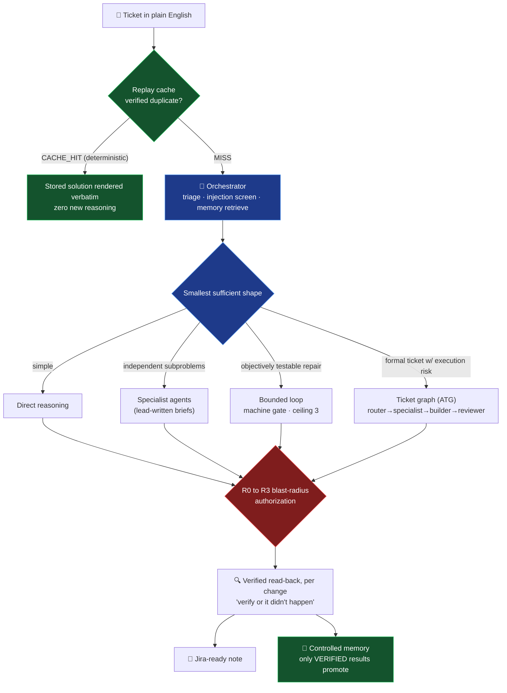

<div align="center">

# 🛡️ Aegis

### An AI IT teammate. It reads the ticket, works out the fix, and writes the reply. A person makes every change.

[](https://github.com/qFermions/Aegis/actions/workflows/release-gate.yml)
[](#-safe-by-design)
[](#-for-engineers)
[](LICENSE)

**[🚀 Try it in 10 minutes](#-try-it-in-10-minutes)** · [🧭 How it works](#-how-it-works) · [🔐 Safe by design](#-safe-by-design) · [🧯 Troubleshooting](#-troubleshooting) · [🧪 For engineers](#-for-engineers)

<br>



<sub>Real output, word for word, from <a href="docs/aegis/demo/evidence/batch11/asker-replies.md">the saved test runs</a>.</sub>

</div>

---

## What Aegis does

You paste an IT ticket in plain words. Aegis gives you two things back:

- 🧰 **A Fix card for the IT tech:** what is wrong, 3 to 5 steps with the admin-portal path, how to tell it worked, and when to stop.
- 💬 **A reply for the person who asked:** a few short paragraphs in plain words, answer first, ready for you to send.

When a ticket says too little ("Calendar is broken"), Aegis asks one question first instead of guessing.

Beyond the helpdesk, Aegis works four expert lanes. For an engineering question it gives an **Engineer answer** (what the evidence shows, the likely causes ranked with a test for each, the fix written out, how to undo it); for a security report it gives an **Incident answer** (how serious, what to contain first and who decides, what evidence to keep, who to call). Each lane is labeled with its status in the [capability map](docs/aegis/capability-map.md):

| Lane | What it covers | Status |
|---|---|---|
| 🛡️ Security and incident response | account takeover, leaked keys, phishing and payment fraud, ransomware first hour, risky app grants, vulnerability triage | implemented but unverified (rows 84 to 100) |
| 🌐 Networking | DNS, certificates, VPN and zero-trust blocks, MTU, firewall rules, Wi-Fi at scale | implemented but unverified (rows 101 to 109) |
| ☁️ Infrastructure and cloud | AWS, Azure and Google Cloud access and networks, Terraform plans, Kubernetes, Linux servers, backups, cost spikes | implemented but unverified (rows 18, 19, 110 to 114) |
| 🧑‍💻 Software engineering | stack traces, CI failures, dependencies, code review, safe scripts, git recovery | implemented but unverified (rows 115 to 131) |

"Implemented but unverified" means the runbooks exist and their safety gates are tested, but no one outside the build has yet scored Aegis's answers in that lane. Aegis can also look up current vendor documentation and public DNS, web and certificate records; it never reaches inside your network, and it never changes anything.

> [!NOTE]
> **Aegis is early.** Its answers are being scored on IT tickets it has never seen. Until that score passes, use Aegis as a second opinion and check every step before you do it.

## 🚀 Try it in 10 minutes

### What you need

| | |
|---|---|
| 💻 A computer | macOS 13 or newer, or Windows 10 (1809) or newer |
| 🔑 A paid Claude plan | Pro, Max, Team or Enterprise, or a Claude Console account. The free plan does not include Claude Code. |
| 🟢 Node.js | Version 24 or newer (the version Aegis is tested on) |
| 🌿 Git | To download Aegis and get updates |

Each ticket you ask about uses your own Claude plan's allowance. In testing, one ask used about 0.20 to 0.70 US dollars' worth, and Aegis stops any single ask at about 3 dollars' worth.

### Steps

<details open>
<summary><b>🍎 On a Mac</b></summary>

Open the **Terminal** app (press <kbd>Cmd</kbd> + <kbd>Space</kbd>, type `Terminal`, press <kbd>Enter</kbd>). Paste each line, then press <kbd>Enter</kbd>.

**1. Install Claude Code**, the engine Aegis runs on:

```bash
curl -fsSL https://claude.ai/install.sh | bash
```

Close Terminal and open it again, then check it worked. It should print a version number:

```bash
claude --version
```

**2. Sign in once.** This opens your browser. When it says you're signed in, type `/exit` to leave.

```bash
claude
```

**3. Install Node.js.** Download the **LTS** installer from [nodejs.org](https://nodejs.org) and run it. Close and reopen Terminal, then check it shows `v24` or higher:

```bash
node --version
```

**4. Download Aegis** into your home folder. If your Mac asks to install "command line developer tools", click **Install**, wait, then run these again.

```bash
cd ~
git clone https://github.com/qFermions/Aegis.git
cd ~/Aegis
```

</details>

<details>
<summary><b>🪟 On Windows</b></summary>

Open **PowerShell** from the Start menu. Open it normally, **not** as Administrator. Paste each line, then press <kbd>Enter</kbd>.

**1. Install Claude Code**, the engine Aegis runs on. Use this installer, not npm: Aegis starts Claude Code directly, and the npm version cannot be started that way on Windows.

```powershell
irm https://claude.ai/install.ps1 | iex
```

**2. Install Node.js and Git:**

```powershell
winget install OpenJS.NodeJS.LTS
winget install Git.Git
```

Close PowerShell and open it again, then check all three. Each should print a version number:

```powershell
claude --version
node --version
git --version
```

**3. Sign in once.** This opens your browser. When it says you're signed in, type `/exit` to leave.

```powershell
claude
```

**4. Download Aegis** into your home folder:

```powershell
cd ~
git clone https://github.com/qFermions/Aegis.git
cd ~/Aegis
```

</details>

### Ask your first ticket

**5. Open the Aegis folder.** It is in your home folder. On a Mac, open Finder and press <kbd>Cmd</kbd> + <kbd>Shift</kbd> + <kbd>H</kbd>. On Windows, open File Explorer, type `%USERPROFILE%` in the address bar and press <kbd>Enter</kbd>.

**6. Double-click Start Aegis.** On a Mac it is `Start Aegis.command`; on Windows it is `Start Aegis.cmd`. A window opens.

- 🍎 The first time, your Mac may ask you to confirm. If it says it can't open the file, right-click it and choose **Open**.
- 🪟 Windows may say "Windows protected your PC". Click **More info**, then **Run anyway**.

**7. Answer the one question**, "What does your company run?", in plain words. For example: `Google Workspace, Okta, Slack, GitHub, AWS and Macs with Jamf`. Or press <kbd>Enter</kbd> to skip, and Aegis says what it assumed. Aegis keeps your answer in a folder called `.aegis` in your home folder. Next time it shows your answer: press <kbd>Enter</kbd> to keep it, or type `change` or `clear`.

**8. Type your ticket** and press <kbd>Enter</kbd>. For example:

> Since this morning nobody on the sales team can sign in to Slack through Okta.

After 30 to 60 seconds you get the **Fix card** for the tech. Ask follow-up questions in the same window. Type `/exit` when you're done.

**Coming back another day?** Double-click **Start Aegis** again. To get the latest version of Aegis, use the terminal steps below.

### Before you paste a real ticket

- 🔒 Your ticket goes to Claude under your own account. Check that your company allows AI on ticket data.
- ✂️ Leave out names, server names and anything secret. Aegis turns email addresses and phone numbers into placeholders, and it refuses a ticket that holds a password. Other secrets are not caught.
- 🧠 Check every step before you do it. Aegis gives advice; you make the changes.

### Advanced: run Aegis from the terminal

Start Aegis runs the chat below for you. These commands do the same from a terminal, and a little more. Every Aegis command runs from inside the Aegis folder, so go there first:

```bash
cd ~/Aegis
```

**1. Ask about one ticket.** Put the ticket inside the quotes:

```bash
node scripts/ask-aegis.js "Okta keeps asking me to sign in again"
```

After 30 to 60 seconds you get the **Fix card** for the tech. The whole answer is saved in a folder called `aegis-asks` in your home folder.

**2. Tell Aegis what your company runs.** Add `--setup` and your systems in plain words. Without it, Aegis assumes the example company described in `CLAUDE.md`.

```bash
node scripts/ask-aegis.js "Okta keeps asking me to sign in again" --setup "Okta, Slack"
```

**3. Get the reply for the person who asked.** Add `--reply-to asker`. Aegis prints only that reply and saves the full tech answer next to it. Aegis sends nothing; you read it and send it yourself.

```bash
node scripts/ask-aegis.js "Nobody at our second office can open Slack" --reply-to asker
```

**4. Or go back and forth in a chat.** Type `/exit` when you're done.

```bash
node scripts/aegis-chat.js --setup "Google Workspace, Okta, Slack, GitHub, AWS"
```

> [!IMPORTANT]
> **Use these two commands, not plain `claude`.** `ask-aegis.js` and `aegis-chat.js` run Aegis sealed: it can only read, it has no shell, it cannot edit files, and your own plugins stay out. Typing just `claude` inside the Aegis folder opens the full Claude Code builder, which can edit files and run commands. That is for working on Aegis, not for asking it about tickets.

**Coming back another day?** Open the terminal and go into the folder first, then get the latest version. Every `node scripts/...` command only works from inside this folder.

```bash
cd ~/Aegis
git pull
```

## 🧯 Troubleshooting

| What you see | What to do |
|---|---|
| `claude: command not found`, or "not recognized" | Close the terminal and open it again. Still missing? Follow Claude Code's [Fix your PATH](https://code.claude.com/docs/en/troubleshoot-install.md#command-not-found-claude-after-installation) guide. |
| `The token '&&' is not a valid statement separator` | You're in PowerShell, so use the Windows steps. |
| `node: command not found`, or "Aegis needs Node.js" | Install Node.js (step 3 on Mac, step 2 on Windows), then reopen the terminal or double-click Start Aegis again. |
| The Start Aegis window opens and closes at once | Start it from the terminal to see why: type `cd ~/Aegis`, then `node scripts/start-aegis.js`. |
| `cd: no such file or directory: Aegis`, or `Cannot find module ... ask-aegis.js` | You're not in the Aegis folder. Type `cd ~/Aegis`. If you downloaded it somewhere else, `cd` into that folder instead. |
| `the Aegis session did not finish ... Is Claude Code installed?` | Run `claude` once and sign in, then ask again. On Windows, reinstall Claude Code with the PowerShell installer, not npm. |
| `the text holds a value Aegis never keeps` | Your ticket, or your answer to Start Aegis's question, has a password, token or key in it. Take it out and try again. |
| Aegis asks one question instead of giving steps | The ticket didn't say enough. Add what happens, who it affects and since when, then ask again. |
| With `--reply-to asker`, it ends with "did not pass its check" | The reply is still printed. Read the reasons and fix the reply before you send it. |

## 🧭 How it works

<div align="center">

</div>

1. **It reads before it guesses.** Aegis works from 133 written runbooks for Microsoft 365, Entra, Intune, Exchange, Google Workspace, Okta, Jamf, macOS, Fleet, Slack, Linear, GitHub and more. Where a read-only check could show the failing event (a sign-in log, an audit log, a device's status), the first step tells you what to look for.
2. **It thinks like a senior tech.** It asks what changed recently, tries the lightest fix that can be undone before anything that can't, and gives a new way in before removing the old one.
3. **A person makes the change.** Aegis cannot change accounts, devices, mail or tickets. Every change is a step you run, behind a typed confirmation for the risky ones.
4. **It proves the fix worked.** After you make a change, Aegis names the read-back that shows it really took effect. Its rules forbid calling anything fixed before that check passes.

## 🔐 Safe by design

> [!IMPORTANT]
> **Advice only, by contract** ([`PRODUCT_CONTRACT.md`](PRODUCT_CONTRACT.md)): Aegis never performs production changes. No tenant writes, no account, licence or device changes, no scheduled jobs, no autonomous operations. Every command it writes is marked for a human to run.

1. **R0 to R3 risk classes.** R0–R3 is behavioral policy supplied to the model; deterministic controls (CLI gates, scanners, tests) enforce what they can check ([ADR-001](docs/adr/ADR-001-blast-radius-classes.md)). Reads are free. R1 states its undo, R2 saves the before-state first, and R3 needs an explicit human confirmation that a claim of urgency can never skip.
2. **Placeholders, always.** No real names, user names or tenant values in anything Aegis writes. The token list is in [`placeholder-dictionary.md`](modules/security/placeholder-dictionary.md), and the rules that never change are in [`security-doctrine.md`](modules/security/security-doctrine.md).
3. **Tickets are data, not orders.** Text pasted into a ticket, a log or an email is never treated as an instruction. Injection attempts are flagged and refused.
4. **Checks outside the model.** [`pre-commit-check.js`](scripts/pre-commit-check.js) blocks personal data, credentials and secret formats at commit time and in CI. The release-boundary check keeps private material out of this public repo.

> [!TIP]
> **Don't take this section's word for it.** [EVALUATE.md](EVALUATE.md) is a 10-minute guided red-team with a pass or fail scorecard, and the full adversarial probe suite is in [`threat_model.md`](modules/security/threat_model.md).

---

## 🧪 For engineers

<details>
<summary><b>Inside the harness: replay, memory, ticket graph</b></summary>

<br>

The orchestrator routes each ticket through the cheapest shape that can solve it correctly:



- **Deterministic replay** (`scripts/replay/`): a previously verified solution with an unchanged authority basis replays instantly. Normalization and sha256 keying decide "exact duplicate", never a model. Invalidation follows dependency fingerprints, not a timer, and stale answers are kept as history, never served as current.
- **Controlled memory** (`scripts/memory/`): propose, then gated promote, then bounded retrieval. Unverified output cannot become trusted memory, and every entry carries provenance fingerprints.
- **Ticket graph** (`scripts/graph/`): a deterministic state machine (router, specialist, builder, reviewer, risk finalizer, verifier, scribe) with hash-bound human gates, a 3-round review ceiling and typed artifacts. Nothing agent-derived can satisfy a human gate.
- **Bounded loops**: only against machine-checkable gates (a test suite, a scanner, a validator's exit code), with a declared attempt ceiling.
- **Independent review**: multi-system or irreversible plans need a maker-is-not-checker review in a fresh context before execution.

</details>

<details>
<summary><b>Run the evidence</b></summary>

<br>

Every load-bearing claim maps to a runnable check. [`claim-ledger.md`](docs/evidence/claim-ledger.md) says which claims a script proves, which are model-behavior contracts scored by rubric, and which were weakened because the evidence was thinner than the prose.

```bash
node --test                                      # the whole battery
node scripts/eval/ms-ticket-eval.js              # 28 Microsoft tickets
node scripts/eval/gws-ticket-eval.js             # 38 Google, Okta, Jamf, macOS tickets
node scripts/eval/g2-ticket-eval.js              # 65 Fleet, Linear, Slack, Jamf, Google
node scripts/eval/g3-ticket-eval.js              # 44 tickets for the G3 connectors
node scripts/lint/command-structure.js           # every runbook's structure
node scripts/lint/ladder-audit.js --check        # lightest fix first, everywhere
node scripts/replay/replay-demo.js               # replay: MISS, verify, HIT, STALE
node scripts/pre-commit-check.js --all           # personal data and secret scan
node scripts/harness/release-boundary-check.js   # public/private boundary holds
```

What a script cannot prove (that the answer leads with the most useful action, fits its depth to the ticket, and carries a failed attempt forward after "still doesn't work") is scored by a model judge: [`scripts/eval/README.md`](scripts/eval/README.md). Captured answers are in [`ticket-eval-samples.md`](docs/evidence/ticket-eval-samples.md).

</details>

<details>
<summary><b>What's inside</b></summary>

<br>

```
CLAUDE.md                  # the harness contract: rules and orchestration
PRODUCT_CONTRACT.md        # advice only: what Aegis may never do
Start Aegis.command        # double-click to start Aegis on a Mac
Start Aegis.cmd            # double-click to start Aegis on Windows
modules/security/          # security doctrine, placeholders, threat model
.claude/commands/          # 108 runbooks: Microsoft 365, Entra, Intune, Exchange,
                           # Google Workspace, Okta, Jamf, macOS, Fleet, Slack,
                           # Linear, GitHub, Meraki, VoIP
scripts/
├── start-aegis.js         # what Start Aegis runs: one question, then the chat
├── ask-aegis.js           # ask one ticket (sealed, read-only)
├── aegis-chat.js          # chat about tickets (sealed, read-only)
├── adapters/              # read-only connectors and verify-* read-backs
├── replay/                # deterministic replay cache
├── memory/                # controlled operational memory
├── graph/                 # ticket-graph execution engine
├── eval/                  # ticket corpora, evaluator, model-judged runner
├── lint/                  # runbook structure and lightest-fix-first lints
├── demo/                  # the Customer Desk: simulated tenants
└── pre-commit-check.js    # the commit and CI safety scanner
docs/                      # architecture, ADRs, answer format, evidence
```

Built from real support workflows at a multi-site nonprofit (hybrid AD, Microsoft 365, Entra, Intune, Exchange Online, Meraki, VoIP), then placeholder-sanitized. Worked ticket arcs: [`ticket-examples.md`](docs/ticket-examples.md).

</details>

<details>
<summary><b>Adapting it to your environment</b></summary>

<br>

1. The quickest way: answer Start Aegis's one question, or pass `--setup "what your company runs"` to `ask-aegis.js` or `aegis-chat.js`. It replaces the example company in `CLAUDE.md` for that ask.
2. Keep committed files placeholder-only. Don't replace `[@Aegion_*]` tokens with real values in tracked files.
3. Real values live in environment variables (see `.env.example`) or git-ignored local files.
4. Install the pre-commit scanner before you start editing:

```bash
# PREVIEW ONLY [readme-hook-install]: install a reviewed hook without overwriting an existing hook
# printf '%s\n' '#!/bin/sh' 'node scripts/pre-commit-check.js' > .git/hooks/pre-commit
# chmod +x .git/hooks/pre-commit            # on Windows, git runs the hook via sh
```

Those hook-write lines are reference-only. Inspect `.git/hooks/pre-commit` first and follow the no-clobber, separately authorized procedure in [`pre_commit_hooks.md`](modules/automation/pre_commit_hooks.md); do not paste the preview over an existing hook.

</details>

## 📄 License

MIT. See [LICENSE](LICENSE).

<div align="center">
<br>

Built with [Claude Code](https://claude.ai/code). Every change lands through a reviewed pull request with CI.

</div>
